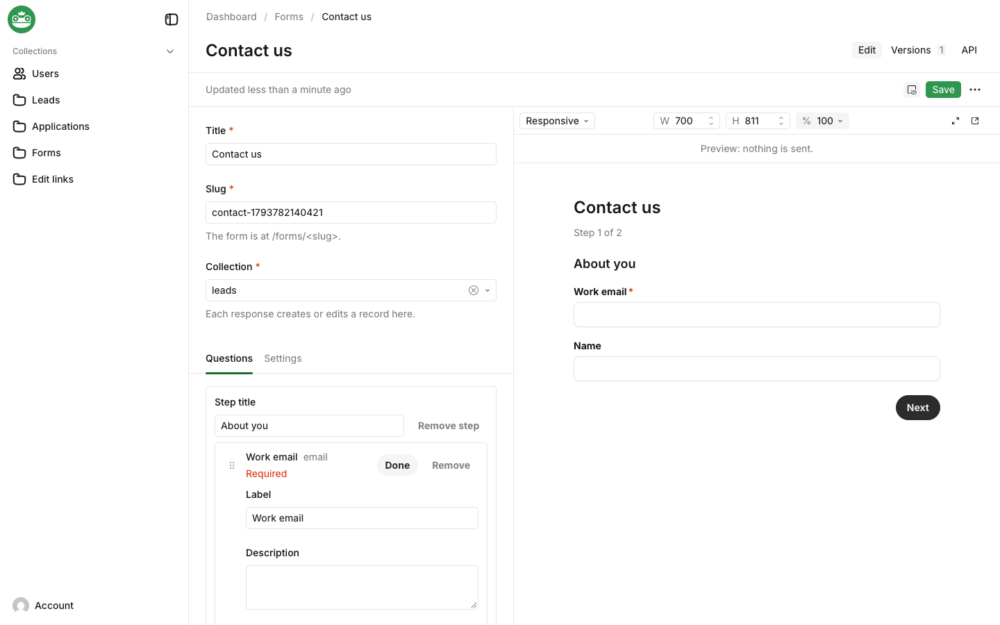

# @frogbotai/plugin-forms

Public forms that create records in FrogBot collections.

```ts
import { formsPlugin } from '@frogbotai/plugin-forms';
import { buildConfig } from 'frogbot';

export default buildConfig({
  secret: process.env.FROGBOT_SECRET!,
  db: databaseAdapter,
  collections: [
    { slug: 'users', auth: true, fields: [] },
    {
      slug: 'leads',
      fields: [
        { name: 'email', type: 'email', required: true },
        { name: 'source', type: 'text' },
      ],
    },
  ],
  plugins: [formsPlugin({ collections: ['leads'] })],
});
```

Admins build forms in the `forms` collection: a slug, the target collection, steps of questions (each one a field of the collection), hidden URL parameters, a confirmation message or redirect, and closing rules (`status`, `closesAt`, `maxResponses`). Saving refuses a form that couldn't create a record, naming the field at fault.



- Building a form: the edit page's **Questions** tab picks questions from the collection's usable fields (refused ones greyed with the reason), warns about required fields the form leaves out, edits each question's wording, groups questions into steps, and reorders them by drag or keyboard. Once saved, Live Preview shows the form as visitors get it while you type, with a **Phone** size; nothing is sent from it.
- Show when: a question's `rules` (`equals`, `notEquals` or `hasValue` on an earlier question's answer, all or `match: 'any'`) show it only for some answers. The page skips steps with nothing to ask, and the server drops hidden answers and files. `required` fields can't have rules.

Each listed collection's `access.create` becomes `isFormSubmission(req, slug) || yourRule(args)`, and the record is created with `overrideAccess: false`, so field access and hooks still run.

- `/forms/<slug>` is the public page, without the admin's chrome. `@frogbotai/ui/forms` exports the same `<Form>` renderer for other frontends.
- `GET /api/forms/:slug/definition` returns the render definition.
- `POST /api/forms/:slug/submit` takes `{ data, params, honeypot?, turnstile? }`, keeps only the form's questions and declared parameters, and returns the confirmation or field errors, never the record.
- File questions: an `upload` field into a listed upload collection, with `maxFileSize`, `maxFiles` (up to 5) and `mimeTypes`, under the app's `upload` limits. Files are sent as multipart, created like the record, deleted when the submit fails, and never returned. Scan them in the upload collection's `beforeChange` hook; boot warns when there's none.
- Edit links: a form in `update` or `both` mode edits one record through a link made with **Create edit link** in the record's menu, `createFormLink(frogbot, { form, record, expiresIn?, maxSubmissions?, req })` or `POST /api/form-links`. The page opens prefilled with the form's questions only and saves through the collection's validation and hooks. Links are random, stored as a hash, last 7 days by default and at most 30 (`links`), and are revoked from the **Edit links** list. Anyone with the URL can edit the record until then.
- Spam protection: a honeypot, optional Cloudflare Turnstile (`turnstile: { siteKey, secretKey }`), and a per-visitor rate limit (`rateLimit`, 10 per 10 minutes) that needs `trustProxy: true` behind a proxy that sets `x-forwarded-for`.

See the [forms documentation](https://docs.frogbot.ai/plugins/forms).
